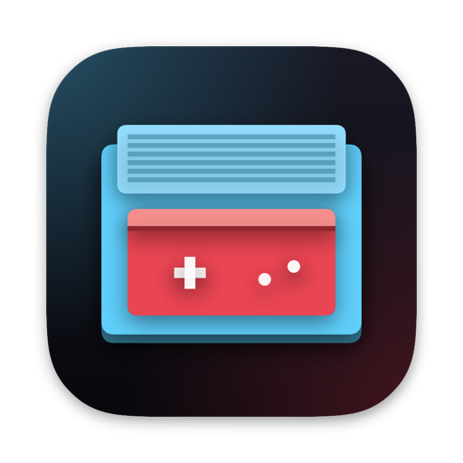
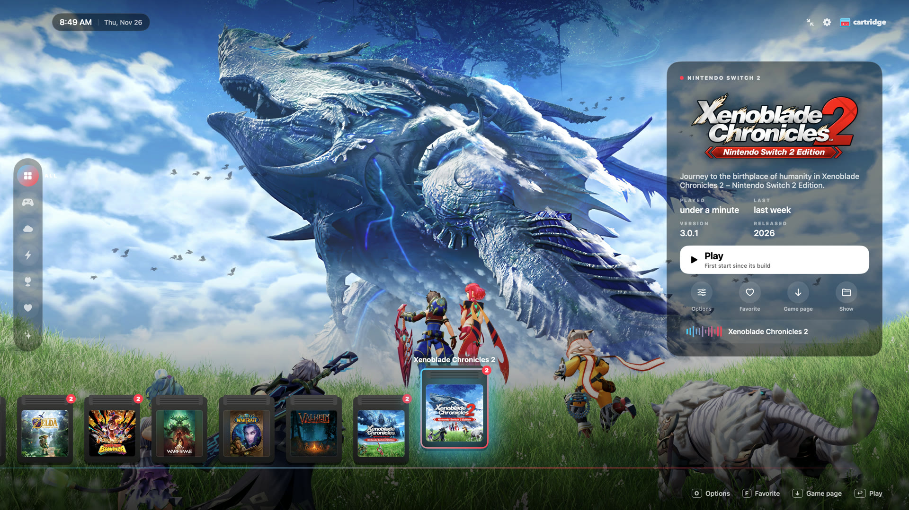
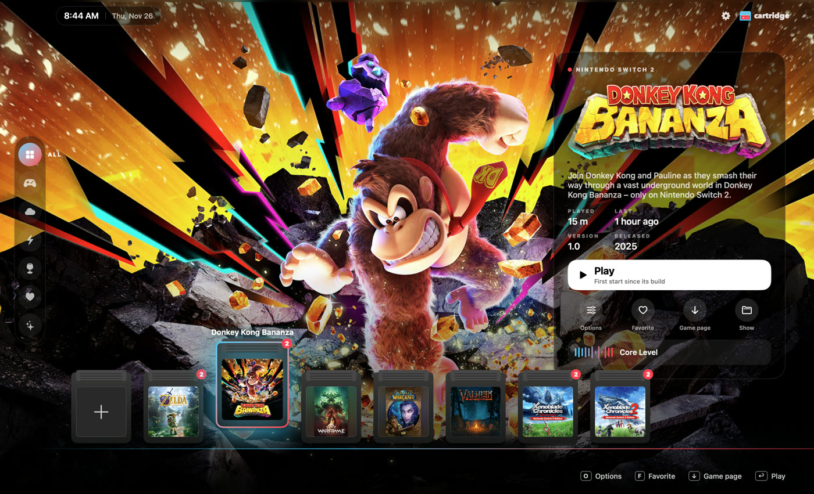

# Cartridge

**Your Switch games, on your Mac, on a shelf.**

**Not an emulator. Build a game in a few clicks, then play it like it came in the box.**

---

Cartridge is a Mac app that keeps all your games in one place. It turns your own Switch and Switch 2 game files into Mac apps, and shows them with your Steam, Battle.net, Epic, GOG and CrossOver games on a shelf you can drive from the couch with a controller. It is built on **[nxnative](https://github.com/seedds/nxnative)**: the game's own code runs on the Apple chip and its graphics are rebuilt on Metal. Nothing from any game is in this repository, and the project is not affiliated with Nintendo or any game publisher.

## What it does

<table>
<tr>
<td width="33%" valign="top"><h3>📚 One shelf</h3>Switch games beside Steam, Battle.net, Epic, GOG, itch.io, Ubisoft, Amazon, Heroic, CrossOver and Whisky, with each game's art, logo and own music.</td>
<td width="33%" valign="top"><h3>🛠️ Few-click builds</h3>Drop in a game, its update and DLC, press Build. Cartridge carries the engine and a setup assistant; only Xcode is needed.</td>
<td width="33%" valign="top"><h3>🛋️ Console mode</h3>Full screen, driven by a controller. A tap of Home in a game brings the shelf up over it, like the console.</td>
</tr>
<tr>
<td valign="top"><h3>📈 Performance coach</h3>After you play, the game's page says how it ran and suggests one setting, with an Apply button.</td>
<td valign="top"><h3>🔄 Always current</h3>Follows nxnative every 3 hours and updates itself. A badge marks the games an update reaches; one click rebuilds them.</td>
<td valign="top"><h3>📱 iPhone and iPad</h3>Install over the cable with your own Apple ID, see which games on the device are out of date, and share saves with the Mac.</td>
</tr>
</table>

<table>
<tr>
<td width="50%"></td>
<td width="50%"></td>
</tr>
<tr>
<td><b>Every game's page</b>: its story, art, screenshots, play time and the game's own music.</td>
<td><b>Options</b>: settings, controls and saves, Rebuild, wallpaper, favourites.</td>
</tr>
<tr>
<td></td>
<td></td>
</tr>
<tr>
<td><b>Per-game settings</b>: screen, frame rate, render scale, MetalFX, HDR, each marked when moved off the tested value.</td>
<td><b>Cartridge's Settings</b>: library sources, music and sounds, look, controllers, HDR, battery, building and updates.</td>
</tr>
</table>

### 🎮 The library
- **Every launcher in one place**, read from the launchers you already have. Filter by store, favourites or *not played yet*.
- **Console mode** for the couch: the D-pad picks a game, A plays it, B goes back. **Home** in a game brings up the shelf over it.
- **Art and music**: background art, logos and screenshots for every game, and each Switch game's own background music, played from its files.
- **Play time**, recently played, a menu bar list of your last five games, and a desktop widget.

### 🛠️ Building
- **No terminal**: `.nsp`, `.xci`, `.nsz`, `.xcz` or a Switch 2 `.nup`, with its update and DLC. Builds a Mac app, an iPhone/iPad IPA, or both.
- **Carries its own engine**: nxnative, its tools and Python ship inside Cartridge. The setup assistant checks the rest and fixes each item with a button.
- **One games folder** on the drive you choose, with free-space checks before every build.
- **Rebuild badge**: only the games an update actually changes ask for a rebuild, and **Use the previous engine** goes back if a new one builds a game worse.

### ⚙️ Playing
- **60 and 120 fps**, MetalFX upscaling, a screen picker with each screen's refresh rate, and lighter settings on battery.
- **HDR** on HDR screens, with a highlights slider per screen.
- **Controls**: remap any controller, rebind the keyboard, use the mouse as the camera stick. Joy-Con 2 pairs split into two players.
- **Saves**: back up and restore with one click, and cloud saves through any synced folder, shared between Mac and iPhone.
- **Screenshots** at the game's own resolution, from the controller's Capture button.
- **Mods and cheats**: browse GameBanana mods and the community cheat database inside Cartridge, one click to add, a switch for each. Kept clean: no adult mods, piracy tools, paid unlocks or online advantages.

## Requirements

- **A Mac with Apple silicon** (M1 or later).
- **Xcode 27.2** for building games: Cartridge's setup assistant opens Apple's download page and checks the rest.
- **Your own game files and your own `prod.keys`**, dumped from your own console. Nothing is bundled, downloaded or looked up for you. Switch 2 `.nup` files and dump folders need no keys.
- For iPhone and iPad: an A17 Pro iPhone or later, or an M1 iPad or later.

## Install

1. Download **Cartridge.zip** from the [latest release](https://github.com/Eriksrevenge1/nxnative/releases/latest) and unzip it.
2. Move **Cartridge.app** to Applications, then open it with **right-click › Open** the first time (it is not signed with a paid Apple certificate).
3. The setup assistant lists what building needs and fixes each item with a button. Choose your games folder and your `prod.keys`.
4. Press the hammer, drop in your game's files, and **Build**. The finished game joins the shelf.

Cartridge checks for new versions by itself (Settings › Updates).

## More

- [Cartridge in detail](../docs/launcher.md): every page and setting.
- [Games that have been tested](../dm/games/README.md#games), each with its own note.
- [nxnative](https://github.com/seedds/nxnative), the project Cartridge is built on, and its [README](../README.md) for building from the command line.
