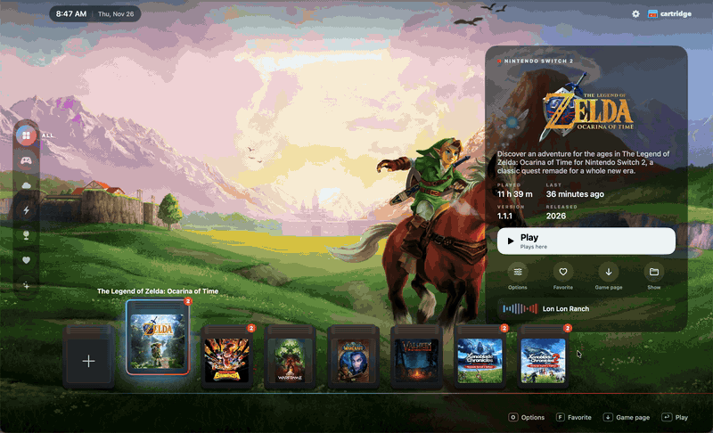
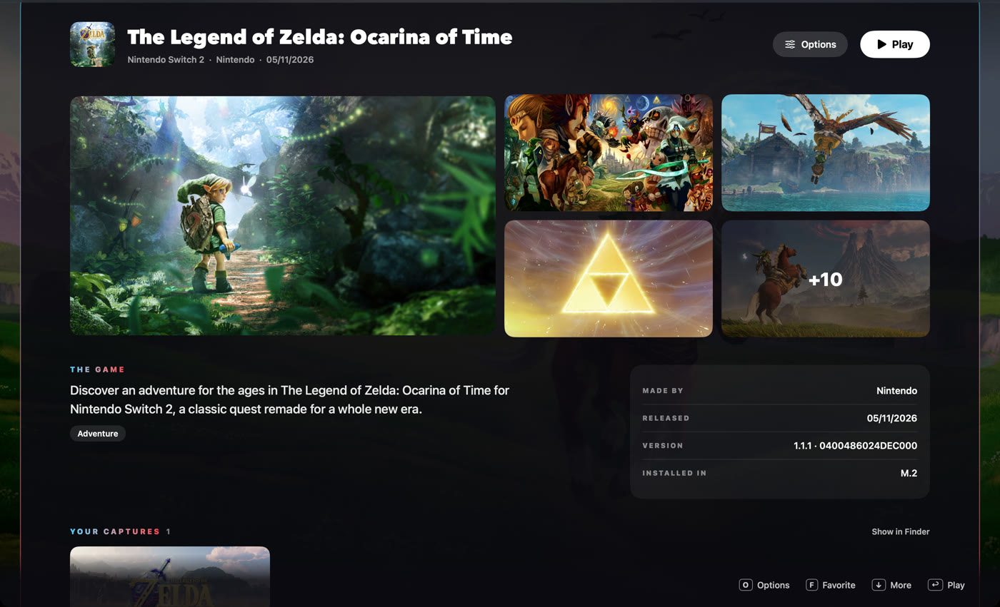
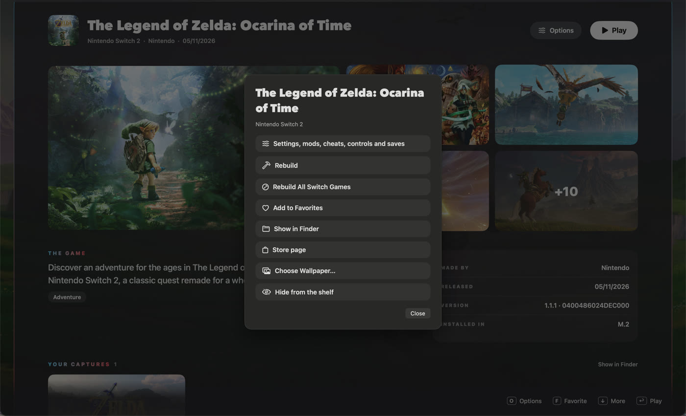
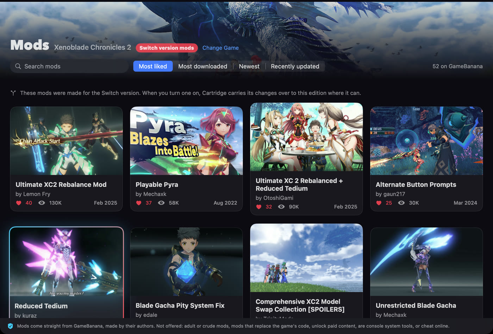
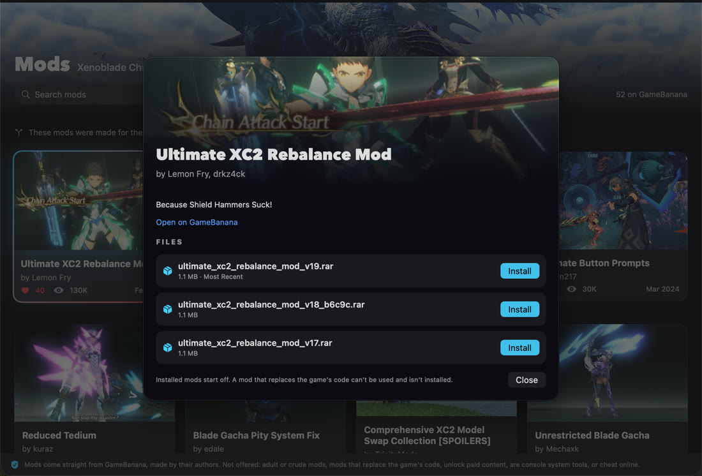
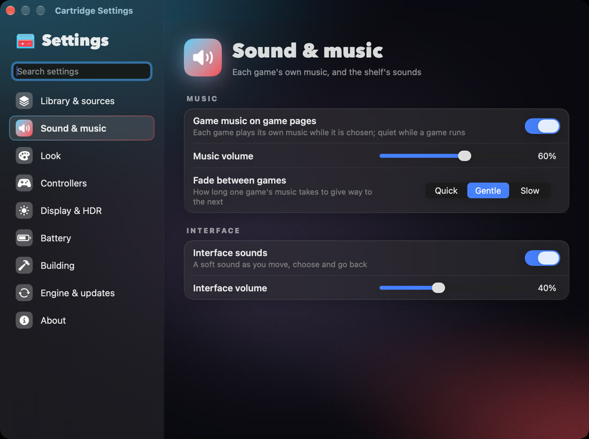
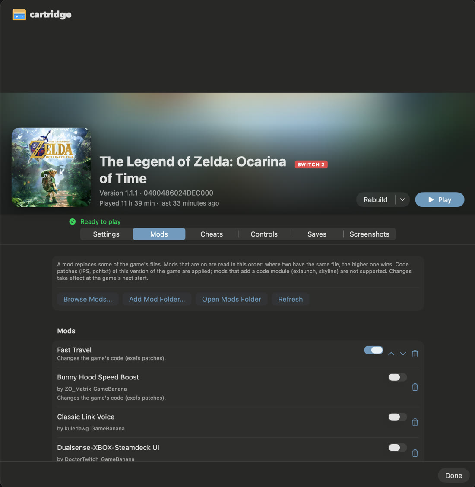
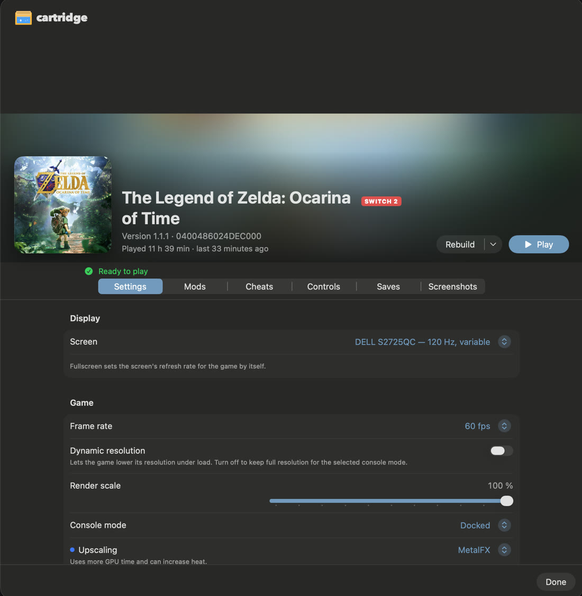

# Cartridge

**Your Switch games, on your Mac, on a shelf.**

**Not an emulator. Build a game in a few clicks, then play it like it came in the box.**

---

Cartridge is a Mac app that keeps all your games in one place. It turns your own Switch and Switch 2 game files into Mac apps, and shows them with your Steam, Battle.net, Epic, GOG and CrossOver games on a shelf you can drive from the couch with a controller. It is built on **[nxnative](https://github.com/seedds/nxnative)**: the game's own code runs on the Apple chip and its graphics are rebuilt on Metal. Nothing from any game is in this repository, and the project is not affiliated with Nintendo or any game publisher.

## What it does

<table>
<tr>
<td colspan="2"></td>
</tr>
<tr>
<td width="50%"></td>
<td width="50%"></td>
</tr>
<tr>
<td><b>Every game's page</b>: its story, art, screenshots, play time and the game's own music.</td>
<td><b>Options</b>: settings, mods, cheats, controls and saves, Rebuild, wallpaper, favourites.</td>
</tr>
</table>

### 🎮 The library
- **One shelf for everything**: your Switch games next to Steam, Battle.net, Epic Games, GOG, itch.io, Ubisoft Connect, Amazon Games, Heroic, CrossOver and Whisky games, read from the launchers you already have. Filter by store, favourites or *not played yet*.
- **Console mode**: the shelf full screen. A controller's D-pad picks a game, A plays it, B goes back. A tap of **Home** in a game brings up the shelf over it, like the console's Home button.
- **Art and music**: background art, logos and screenshots for each game (LaunchBox's community art, the store's pages), and each Switch game's own background music, played from its files.
- **Play time and recently played**, a menu bar list of your last five games, and a desktop widget.
- **Rebuild badge**: a cartridge an update reaches shows a small badge; one click in Options brings every such game up to date.

### 🛠️ Building games
- **A few clicks, no terminal**: drop in a base game (`.nsp`, `.xci`, `.nsz`, `.xcz`, or a Switch 2 `.nup`), its update and DLC. Cartridge builds a Mac app, an iPhone/iPad IPA, or both.
- **Carries its own engine**: nxnative, its tools and Python ship inside Cartridge. Only Xcode is needed, and the setup assistant walks you through it.
- **Updates itself**: each new version (and the nxnative it carries) arrives in the app. Games only ask for a rebuild when an update actually changes them.
- **Install on iPhone or iPad** over the cable with your own Apple ID, and see which of your games are on the device and up to date.

### ⚙️ Playing
- **Per-game settings** as the game's own settings window has them: render scale, frame rate, MetalFX upscaling, HDR, screen choice, and more. Settings changed from the tested value are marked, with **Use Tested** beside them.
- **Performance coach**: after a session, a game's page says how it ran (late frames, GPU time) and suggests one change with an **Apply** button.
- **60 and 120 fps**, HDR on HDR screens with a highlights slider per screen, and lighter settings on battery.
- **Controls**: remap any controller, rebind the keyboard, use the mouse as the camera stick. Joy-Con 2 pairs split into two players.
- **Saves**: back up and restore with one click, and cloud saves through any synced folder, shared between Mac and iPhone.
- **Screenshots** at the game's own resolution, from the controller's Capture button.

### 🧩 Mods and cheats
- **Browse Mods** from GameBanana inside Cartridge, install with one click, turn them on and off, and choose which wins where two change the same file. Code patches (IPS, pchtxt) are built into the game.
- **Find Cheats** for your exact game version from the community cheat database, tick the ones you want, and switch them on and off.
- Kept clean: no adult or crude mods, no piracy tools, no paid-content unlocks, nothing that gives an advantage online.

<table>
<tr>
<td width="50%"></td>
<td width="50%"></td>
</tr>
<tr>
<td><b>One click to install</b>: every file of a mod, straight from its authors' page.</td>
<td><b>Cartridge's Settings</b>: library sources, music and sounds, look, controllers, HDR, battery, building and updates.</td>
</tr>
<tr>
<td width="50%"></td>
<td width="50%"></td>
</tr>
<tr>
<td><b>Mods</b>: install, switch on and off, and order them.</td>
<td><b>Settings</b>: screen, frame rate, render scale, MetalFX and more, per game.</td>
</tr>
</table>

## Requirements

- **A Mac with Apple silicon** (M1 or later).
- **Xcode 27.2** for building games: Cartridge's setup assistant opens Apple's download page and checks the rest.
- **Your own game files and your own `prod.keys`**, dumped from your own console. Nothing is bundled, downloaded or looked up for you. Switch 2 `.nup` files and dump folders need no keys.
- For iPhone and iPad: an A17 Pro iPhone or later, or an M1 iPad or later.

## Install

1. Download **Cartridge.zip** from the [latest release](https://github.com/Eriksrevenge1/nxnative/releases/latest) and unzip it.
2. Move **Cartridge.app** to Applications, then open it with **right-click › Open** the first time (it is not signed with a paid Apple certificate).
3. The setup assistant lists what building needs and fixes each item with a button. Choose your games folder and your `prod.keys`.
4. Press the hammer, drop in your game's files, and **Build**. The finished game joins the shelf.

Cartridge checks for new versions by itself (Settings › Updates).

## More

- [Cartridge in detail](../docs/launcher.md): every page and setting.
- [Games that have been tested](../dm/games/README.md#games), each with its own note.
- [nxnative](https://github.com/seedds/nxnative), the project Cartridge is built on, and its [README](../README.md) for building from the command line.
